# IGs88H — Integrative Graph Search Bug Bounty Hunter

Multi-layer system for automated code analysis. An orchestrator-driven traversal
engine walks code knowledge graphs (via [Graphify](https://github.com/safishamsi/graphify)
or built-in AST), sending each node's code to an LLM for analysis. Bottom-up by
default: leaves first, results bubble up to parents. Multi-provider support
(Anthropic Claude, Google Gemini, OpenAI, and local models via any OpenAI-compatible API).
*Please note that OpenAI is currently experimental.*

## Architecture



```
Traversal Orchestrator (bottom-up / DFS / BFS / by-type)
    │
    ├── CodeGraph Adapter
    │       │
    │       ├── Graphify (primary) — multi-language, AST + semantic extraction
    │       ├── Built-in AST (fallback) — Python only
    │       │
    │       ├── Nodes: functions, classes, methods, modules
    │       └── Edges: calls, imports, inherits, contains
    │
    ├── LLM Analysis (per-node, orchestrator-controlled)
    │       │
    │       ├── Anthropic (Claude Sonnet/Haiku) — with optional analysis tools
    │       ├── Google Gemini (via Vertex AI) — two-pass: static hints + verification
    │       ├── Local models (Ollama, llama.cpp, LM Studio, vLLM) — via OpenAI-compatible API
    │       │
    │       └── Analysis Tools
    │           └── static_analysis  – pattern-based lint (always available)
    │
    └── Result Store
            per-node results → report → results/{model}/{task}/{codebase}/
```

### Key design: the LLM is a pure analysis function

The LLM has **no graph traversal tools**. It cannot read files, navigate the graph,
or spawn child agents. The orchestrator controls all traversal, sends each node's
code as a single prompt, and collects the response. This keeps context small and
costs predictable — 2 API calls per node (standard) or 3 with deep analysis.

## Quick Start

```bash
# Install deps
pip install anthropic google-genai openai python-dotenv --break-system-packages

# Install Graphify for multi-language graph extraction
uv tool install graphifyy

cp .env.example .env  # fill in API keys

# Analyze a codebase with Claude Sonnet (bottom-up, security audit)
python igs88h.py /path/to/project --strategy bottom_up --task security --model claude-sonnet-5-5

# Without --model, the default model from models.json is used (see "Choosing Models")
python igs88h.py /path/to/project --strategy bottom_up --task security

# Same analysis with Gemini Flash
python igs88h.py /path/to/project --strategy bottom_up --task security --model gemini-3.5-flash

# Use a local model via Ollama (default: http://localhost:11434/v1)
python igs88h.py /path/to/project --task security --local --model llama3

# Local model with a custom API endpoint (llama.cpp, LM Studio, vLLM, etc.)
python igs88h.py /path/to/project --local --model codellama --api-url http://localhost:8080/v1

# Deep analysis (3-pass) — higher recall, catches commonly missed vulns
python igs88h.py /path/to/project --task security --model gemini-3.5-flash --deep-analysis

# Output to organized results folder
python igs88h.py /path/to/project --task security --model gemini-3.5-flash \
  --output results/gemini-3.5-flash/security/myproject/report.json

# Dry run: see what would be analyzed
python igs88h.py /path/to/project --dry-run

# With an existing Graphify graph.json
python igs88h.py --graph /path/to/graph.json
```

## Choosing Models

Model names are plain strings, so a new model needs no code change. There are two ways to pick one:

1. **For one run**, pass `--model <model-id>`.
2. **To change the default**, edit `default_model` in [`models.json`](models.json):

   ```json
   "default_model": "claude-sonnet-5-5",
   ```

   Any run without `--model` then uses it. The same file holds the benchmark model list and
   per-model prices (see [Benchmarking](#benchmarking)).

The model ID's prefix decides which provider is called:

| Model ID starts with | Provider | Credentials |
|---|---|---|
| `gemini` | Google Gemini on Vertex AI (express mode) | `GEMINI_API_KEY` (Vertex express key) |
| `gpt-`, `o1`, `o3`, `o4`, `chatgpt-` | OpenAI *(experimental)* | `OPENAI_API_KEY` |
| anything, with `--local` | Local OpenAI-compatible server | none |
| anything else (e.g. `claude-…`) | Anthropic | `ANTHROPIC_API_KEY` |

Use the exact model ID the provider publishes, and check the provider's model list and
retirement dates. Google, for example, retired `gemini-2.5-*` on Vertex AI on 2026-10-20.
After that, requests for it return `404 Publisher model ... not found` even though the API key is
valid.

Output-length and effort controls:

| Flag | Default | Notes |
|---|---|---|
| `--max-tokens N` | `4096` | Max output tokens per LLM call. On Claude 5.x models thinking is always on, and thinking tokens count against this limit. |
| `--effort LEVEL` | not sent | Anthropic only: `low`, `medium`, `high`, `xhigh`, `max`. When unset, the model's default applies (`claude-opus-5-5`: medium; most others: high). |

Every report's `summary` records `total_input_tokens`, `total_output_tokens`, `llm_calls`,
`stop_reasons`, `truncated_calls` and `refused_calls`. A pass that hit `--max-tokens` or that the
provider refused is still kept and scored, so check these counts before trusting a result.

## Walkthrough: Analyzing DSVW

[DSVW](https://github.com/stamparm/DSVW) (Damn Small Vulnerable Web) is a
deliberately vulnerable Python web app — a good test target. This repo
includes our pre-built Graphify graph and ground truth for DSVW under
`examples/datasets/dsvw/`, but **not** the vulnerable source code itself.

> **Warning:** DSVW is intentionally insecure. Do not run it on a network you
> care about. Clone it at your own risk, and treat the code as text-only input
> for analysis — never execute it.

```bash
# 1. Clone DSVW source
git clone https://github.com/stamparm/DSVW.git /tmp/dsvw
cp /tmp/dsvw/dsvw.py examples/datasets/dsvw/dsvw.py

# 2. Copy the ground truth file into the dataset directory
cp examples/datasets/dsvw_ground_truth.json examples/datasets/dsvw/ground_truth.json
```

### Every task, one codebase

```bash
# See what would be analyzed (no API calls)
python igs88h.py examples/datasets/dsvw --dry-run --strategy bottom_up

# General analysis — summarize, find bugs, assess complexity
python igs88h.py examples/datasets/dsvw --task analyze --model gemini-3.5-flash \
  --output results/gemini-3.5-flash/analyze/dsvw/report.json

# Security audit — OWASP-focused, severity ratings, CWE identifiers
python igs88h.py examples/datasets/dsvw --task security --model gemini-3.5-flash \
  --output results/gemini-3.5-flash/security/dsvw/report.json

# Data flow — trace inputs through transforms to sinks, flag taint paths
python igs88h.py examples/datasets/dsvw --task dataflow --model gemini-3.5-flash \
  --output results/gemini-3.5-flash/dataflow/dsvw/report.json

# Best practices — PEP8, naming, error handling, magic values
python igs88h.py examples/datasets/dsvw --task practices --model gemini-3.5-flash \
  --output results/gemini-3.5-flash/practices/dsvw/report.json

# OOP design — SOLID violations, encapsulation, scoping
python igs88h.py examples/datasets/dsvw --task oop --model gemini-3.5-flash \
  --output results/gemini-3.5-flash/oop/dsvw/report.json

# Duplication — internal + cross-node code clones, boilerplate
python igs88h.py examples/datasets/dsvw --task duplication --model gemini-3.5-flash \
  --output results/gemini-3.5-flash/duplication/dsvw/report.json

# Refactoring — SRP, extract method, dead code, design patterns
python igs88h.py examples/datasets/dsvw --task refactor --model gemini-3.5-flash \
  --output results/gemini-3.5-flash/refactor/dsvw/report.json

# Dependency audit — imports, coupling level, circular risks
python igs88h.py examples/datasets/dsvw --task deps --model gemini-3.5-flash \
  --output results/gemini-3.5-flash/deps/dsvw/report.json

# Test generation — runnable pytest code with mocks and edge cases
python igs88h.py examples/datasets/dsvw --task test_gen --model gemini-3.5-flash \
  --output results/gemini-3.5-flash/test_gen/dsvw/report.json

# Deep security analysis (3-pass) — catches CWEs missed by standard
python igs88h.py examples/datasets/dsvw --task security --model gemini-3.5-flash \
  --deep-analysis --output results/gemini-3.5-flash-3pass/security/dsvw/report.json
```

## Task Factories

| Task | Flag | What it does |
|------|------|-------------|
| `analyze` | `--task analyze` | Summarize, find bugs, assess complexity and efficiency |
| `security` | `--task security` | OWASP-focused security audit, severity ratings |
| `dataflow` | `--task dataflow` | Data flow tracing, taint paths, dead assignments, unused params |
| `practices` | `--task practices` | Language-aware best practices (PEP8, Google C++, etc.) |
| `oop` | `--task oop` | SOLID violations, encapsulation, scoping, misplaced logic |
| `duplication` | `--task duplication` | Internal + cross-node code duplication, boilerplate |
| `refactor` | `--task refactor` | SRP, extract method, dead code, design patterns |
| `deps` | `--task deps` | Dependency audit, coupling analysis |
| `test_gen` | `--task test_gen` | Generate pytest unit tests |

## Analysis Modes

| Mode | Flag | Passes | What happens |
|------|------|:------:|--------------|
| Standard | _(default)_ | 2 | Static hints + analysis, then verification pass |
| Deep | `--deep-analysis` | 3 | Standard + targeted pass for commonly missed CWE classes |

The deep analysis pass specifically targets: eval/exec injection (CWE-95), HTTP
header injection (CWE-113), parameter pollution (CWE-235), missing security headers
(CWE-1021), execution after redirect (CWE-698), timing attacks, and log injection
(CWE-117). Both modes work with all providers (Anthropic and Gemini).

## Security Analysis Accuracy

Evaluated against ground truth on two vulnerable datasets. See
[analysis.md](analysis.md) for the full report including per-CWE breakdowns,
confusion matrices, and cost analysis.

Measured in June 2026 with Gemini 2.5 Flash, which has since been retired on Vertex AI. To
re-measure with current models, see [Benchmarking](#benchmarking).

| Config | GT CWEs | TP | FN | Recall (exact) | Recall (broad) |
|--------|:-------:|:--:|:--:|:--------------:|:--------------:|
| Gemini 2.5 Flash — standard (2-pass) | 26 | 21 | 5 | 80.8% | 80.8% |
| Gemini 2.5 Flash — deep (3-pass) | 26 | 25 | 1 | 96.2% | **100%** |

**Deep analysis catches the hardest vulnerabilities.** The 4 CWEs missed by
standard analysis — CWE-113 (header injection), CWE-235 (parameter pollution),
CWE-1021 (clickjacking), CWE-698 (execution after redirect) — are all detected
by the deep analysis pass. The remaining exact-match miss (CWE-95) is a
classification issue: `exec()` is flagged as CWE-78 (command injection) rather
than CWE-95 (eval injection), both in the same vulnerability family.

**Token overhead:** ~+20% on small codebases (6 nodes), ~+53% on larger ones (72 nodes).

## Benchmarking

`benchmark.py` runs the same task, with the same flags, for several models over several
datasets, then scores all reports in one side-by-side table. The models, datasets and prices it
uses come from the `benchmark` block in [`models.json`](models.json):

```json
"benchmark": {
  "models": ["claude-sonnet-5-5", "claude-opus-5-5", "gemini-3.5-flash", "claude-sonnet-4-6"],
  "task": "security",
  "strategy": "bottom_up",
  "parallel": 4,
  "datasets": {
    "dsvw":         {"graph": "examples/datasets/dsvw/graph.json", "ground_truth": "dsvw-builtin", "passes": [2, 3]},
    "securityeval": {"graph": "examples/datasets/securityeval/graph.json",
                     "ground_truth": "examples/datasets/securityeval_ground_truth.json", "passes": [3]},
    "igs88h":       {"codebase": ".", "ground_truth": null, "passes": [3]}
  }
}
```

To benchmark a different model, add or replace its ID in `models`. `passes` is 2 (standard) or
3 (`--deep-analysis`). `ground_truth` is a CWE JSON file, `"dsvw-builtin"` for the DSVW
categories built into the scorer, or `null` to report findings without precision or recall.
Optional `max_tokens` and `effort` keys are passed through to every run.

```bash
python benchmark.py plan     # run matrix, existing reports, rough cost; no API calls
python benchmark.py run      # run every missing report (paid API calls)
python benchmark.py run --models claude-sonnet-5-5 --datasets dsvw   # one cell group
python benchmark.py score    # score every report under results/; no API calls
python benchmark.py score --json results/benchmark_scores_2026-10-28.json
```

- Reports are written to `results/<model>[-3pass]/<task>/<dataset>/report.json`, with that run's
  log in `run.log` beside it.
- An existing report is never overwritten. To rerun a cell, move the old report aside first.
- Models run concurrently, since each has its own rate limit. Each model's datasets run one
  after another.
- `score` covers every report it finds for each dataset, including older runs. It prints TP, FP,
  FN, precision, recall and F1 (as distinct CWEs vs ground truth), plus input and output tokens,
  estimated cost, time, truncated and refused calls, and errors.
- Rows marked `*` are legacy reports from code older than 2026-10-28. They have no token split
  or stop reasons, so their cost and truncation columns show `n/a`.
- A cost marked `?` uses a price that hasn't been confirmed against the provider's pricing page.
- For a `codebase` dataset, `igs88h.py` reuses `graphify-out/graph.json` and never refreshes it.
  `plan` warns when that graph is older than the source. Move the graph aside to rebuild it.

## Task Scorecard — Gemini 2.5 Flash on DSVW (6 nodes, June 2026)

All 9 task factories tested against [DSVW](https://github.com/stamparm/DSVW)
(Damn Small Vulnerable Web), bottom-up traversal, standard 2-pass analysis:

| Task | Nodes | Errors | Tokens | Time |
|------|:-----:|:------:|-------:|-----:|
| `analyze` | 6 | 0 | 54,350 | 607s |
| `security` | 6 | 0 | 54,373 | 596s |
| `dataflow` | 6 | 0 | 67,296 | 767s |
| `practices` | 6 | 0 | 55,436 | 625s |
| `oop` | 6 | 0 | 52,176 | 612s |
| `duplication` | 6 | 0 | 38,226 | 792s |
| `refactor` | 6 | 0 | 53,950 | 680s |
| `deps` | 6 | 0 | 54,502 | 650s |
| `test_gen` | 6 | 0 | 68,107 | 916s |

54/54 nodes analyzed, 0 errors across all tasks.

## Traversal Strategies

| Strategy | Order | Best For |
|----------|-------|----------|
| `bottom_up` | Leaves first (post-order) — **default** | Dependency-aware analysis |
| `dfs` | Root → depth-first children | Call chain analysis |
| `bfs` | Level by level | Broad overview |
| `by_type` | Functions → classes → modules | Type-specific audits |

## Multi-Provider Support

| Provider | Model examples | Analysis mode | Env var |
|----------|---------------|---------------|---------|
| Anthropic | `claude-sonnet-5-5`, `claude-opus-5-5`, `claude-haiku-4-5` | Multi-pass: static hints + verification (+ deep) | `ANTHROPIC_API_KEY` |
| Google Gemini | `gemini-3.5-flash` | Multi-pass: static hints + verification (+ deep) | `GEMINI_API_KEY` |
| OpenAI *(experimental)* | `gpt-4o`, `gpt-4.1` | Multi-pass: static hints + verification (+ deep) | `OPENAI_API_KEY` |
| Local models | `llama3`, `codellama`, `qwen2.5-coder`, any | Multi-pass: static hints + verification (+ deep) | None (uses `--local`) |

### Local Model Support

Use the `--local` flag to run analysis against any OpenAI-compatible API server. No API key needed.

```bash
# Ollama (default endpoint: http://localhost:11434/v1)
python igs88h.py /path/to/project --task security --local --model llama3

# Custom endpoint (llama.cpp, LM Studio, vLLM, etc.)
python igs88h.py /path/to/project --local --model codellama --api-url http://localhost:8080/v1
```

| Flag | Purpose | Default |
|------|---------|---------|
| `--local` | Enable local model mode | _(off)_ |
| `--api-url` | Custom API endpoint | `http://localhost:11434/v1` (Ollama) |
| `--model` | Model name as served by the local API | _(required)_ |

Compatible with [Ollama](https://ollama.com), [llama.cpp](https://github.com/ggml-org/llama.cpp), [LM Studio](https://lmstudio.ai), [vLLM](https://github.com/vllm-project/vllm), and any server exposing an OpenAI-compatible `/v1/chat/completions` endpoint.

## Graph Integration

The CodeGraph adapter auto-detects graph format (Graphify, generic nodes/edges, symbols):

- **[Graphify](https://github.com/safishamsi/graphify)** — primary support, multi-language
  (Python, C/C++, JS/TS, Go, Rust, Java, Ruby, PHP). Install: `uv tool install graphifyy`
- **Built-in AST** — Python-only fallback via `ast` module Note: Not as good as Graphify

When Graphify is installed, `igs88h.py` runs `graphify update --no-cluster` automatically
(code-only extraction, no LLM key needed). Source code is loaded from disk for nodes
that don't have inline code in the graph.

## Results Organization

```
results/
├── claude-sonnet-4-6/           # standard (2-pass)
│   └── security/
│       └── dsvw/
├── claude-sonnet-4-6-3pass/     # deep analysis (3-pass)
│   └── security/
│       └── dsvw/
├── gemini-3.5-flash/            # standard (2-pass)
│   └── security/
│       ├── dsvpwa/
│       └── dsvw/
├── gemini-3.5-flash-3pass/      # deep analysis (3-pass)
│   └── security/
│       ├── dsvpwa/
│       └── dsvw/
│           └── report.json
```

## Support & Consulting

If you like what we've built and want to support the research behind it, you can donate to [ESB AI Lab](https://esbailab.org):

- **PayPal:** [Donate via PayPal](https://www.paypal.com/ncp/payment/VM5L2HJ2TLSTN)
- **Zeffy (zero fees):** [Donate via Zeffy](https://www.zeffy.com/en-US/donation-form/supporting-esb-ai-lab-research-and-mentorship)
- **Check:** ESB AI Lab Corporation, 1455 Frazee Rd Ste 500, San Diego, CA

For consulting and custom engagements, visit [edgeconsults.com](https://edgeconsults.com).
